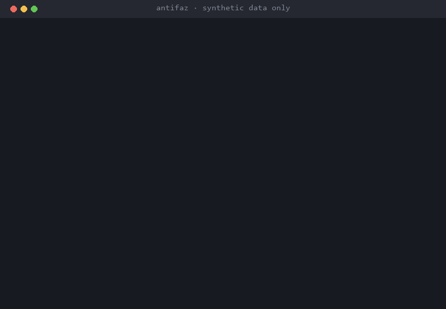

<p align="center"></p>

<h1 align="center">Antifaz</h1>

<p align="center"><b>Usa la IA con datos de clientes sin enviarle sus datos.</b><br><a href="README.md">Read in English</a></p>

<p align="center">
  <a href="https://github.com/miquel-moreno/antifaz/releases"></a>
  <a href="https://github.com/miquel-moreno/antifaz/actions/workflows/ci.yml?query=branch%3Amain"></a>
  <a href="LICENSE"></a>
  <a href="https://www.python.org/"></a>
  <a href="https://fastapi.tiangolo.com/"></a>
  <a href="https://github.com/miquel-moreno/antifaz/pkgs/container/antifaz"></a>
  <a href="#puesta-en-marcha"></a>
  <a href="https://github.com/miquel-moreno/antifaz/releases/tag/v0.1.1"></a>
  <a href="https://github.com/miquel-moreno/antifaz/stargazers"></a>
</p>

**EN** · Use any LLM with your customers' data, without sending it.

Las empresas quieren usar ChatGPT o Claude con emails y documentos de clientes, pero enviarles datos personales es un riesgo para la privacidad. Antifaz se pone en medio y cambia esos datos por marcadores antes de que salga el texto.



## Qué hace
- Encuentra los datos personales del texto, con foco en los identificadores españoles y europeos (DNI, NIE, número de la Seguridad Social, IBAN…), y los cambia por marcadores como `[[ES_DNI_1]]`.
- Envía a OpenAI o Anthropic solo los marcadores y vuelve a poner los valores reales en la respuesta.
- Si algo falla al revisar una petición, la bloquea en vez de dejarla pasar.

## Resultado
- En un benchmark público en español, los nombres que quedan a la vista bajan de 100 a 2,5 de cada 100 con el detector de nombres opcional (también tapa algo de texto que no es personal: detalles abajo).
- Revisa un documento en unos 3 milisegundos sin el detector de nombres, y pasa 960 tests de ataque.

## Tecnologías
Python · FastAPI · APIs de LLM (OpenAI, Anthropic) · NLP (GLiNER) · Privacidad (RGPD) · Docker · GitHub Actions · pytest

## Mi papel
Lo he diseñado y desarrollado de principio a fin. Desarrollo asistido por IA bajo mi especificación y revisión.

[Detalles técnicos →](docs/TECNICO.md) · [LinkedIn](https://www.linkedin.com/in/miquel-moreno-martinez)

---

> [!WARNING]
> **Beta: [ya está publicada la v0.1.1](https://github.com/miquel-moreno/antifaz/releases/tag/v0.1.1).** Antifaz **no garantiza encontrar todos los datos personales**: solo protege lo que detecta, y el [benchmark](docs/benchmark.md) dice cuánto se escapa. Pruébalo con tu tipo de textos antes de usarlo con datos reales.

## Puesta en marcha

Necesitas Docker con Compose, y git. **Guía de instalación** para empresas, paso a paso (también Windows, Claude Code, actualizaciones y problemas frecuentes): [docs/instalacion.md](docs/instalacion.md) · [in English](docs/install.md).

Hay dos caminos. **Instalar la v0.1.1 publicada** funciona hoy. **Llega con la v0.2.0** solo está en `main`: no funciona con la imagen 0.1.1.

### Instalar la v0.1.1 publicada (hoy)

Todas estas órdenes funcionan con la imagen publicada `ghcr.io/miquel-moreno/antifaz:0.1.1`.

```bash
git clone https://github.com/miquel-moreno/antifaz && cd antifaz
cp .env.example .env
# Edita .env:
#   ANTIFAZ_API_KEY: un valor aleatorio, por ejemplo la salida de `openssl rand -hex 32`
#   ANTIFAZ_OPENAI_API_KEY y/o ANTIFAZ_ANTHROPIC_API_KEY: las claves de tus proveedores
#   (borra la línea del proveedor que no uses: su ruta responde 503)
#   ANTIFAZ_ADMIN_TOKEN: otro valor aleatorio, distinto de ANTIFAZ_API_KEY, o borra la línea
docker compose up -d                 # descarga ghcr.io/miquel-moreno/antifaz:0.1.1
curl http://127.0.0.1:8000/healthz   # {"status":"ok","version":"0.1.1"}
```

En Windows (PowerShell), lo mismo con `Copy-Item` y `curl.exe`. Edita `.env` (guardado en UTF-8) antes de `docker compose up -d`. Para crear un valor aleatorio en PowerShell, mira la [guía de instalación](docs/instalacion.md#22-escribir-el-archivo-env).

```powershell
git clone https://github.com/miquel-moreno/antifaz; cd antifaz
Copy-Item .env.example .env
docker compose up -d
curl.exe http://127.0.0.1:8000/healthz
```

`ANTIFAZ_ADMIN_TOKEN` es para el panel del navegador de la v0.2.0. La 0.1.1 lo ignora, pero la v0.2.0 no arranca mientras tenga su valor de ejemplo. Así que genéralo ahora o borra la línea (entonces el panel se queda apagado).

Antifaz se niega a arrancar mientras una clave tenga su valor de ejemplo (`change-me...`); `docker compose logs antifaz` dice qué variable hay que arreglar, nunca su valor. Solo escucha en `127.0.0.1`: para llegar desde otras máquinas, pon delante un proxy inverso con HTTPS ([detalles](docs/TECNICO.md)).

**Sin Compose**, el mismo endurecimiento en un solo `docker run` (bash; para PowerShell, mira [la guía de instalación, 2.4](docs/instalacion.md#24-sin-compose-un-solo-docker-run)):

```bash
docker run -d --name antifaz --env-file .env -p 127.0.0.1:8000:8000 \
  --read-only --tmpfs /tmp:size=16m,mode=1777,noexec,nosuid,nodev \
  --cap-drop ALL --security-opt no-new-privileges \
  --memory 512m --cpus 1 --pids-limit 128 --restart unless-stopped \
  ghcr.io/miquel-moreno/antifaz:0.1.1
```

Para comprobar tu configuración sin llamar a ningún proveedor (con Compose):

```bash
docker compose exec antifaz antifaz verify
```

Planta valores falsos en cada parte de una petición y falla si alguno llega a un proveedor falso.

Después, apunta tu cliente a Antifaz en vez de al proveedor, con tu `ANTIFAZ_API_KEY` como clave (las claves de los proveedores se quedan en `.env`):

```python
from openai import OpenAI

client = OpenAI(base_url="http://localhost:8000/v1", api_key="<tu ANTIFAZ_API_KEY>")
```

```python
from anthropic import Anthropic

client = Anthropic(base_url="http://localhost:8000", api_key="<tu ANTIFAZ_API_KEY>")
```

```bash
curl http://localhost:8000/v1/chat/completions \
  -H "Authorization: Bearer $ANTIFAZ_API_KEY" -H "Content-Type: application/json" \
  -d '{"model": "gpt-4.1-nano", "messages": [{"role": "user", "content": "Mi DNI es 12345678Z"}]}'
```

Qué funciona en la v0.1: OpenAI Chat Completions y Anthropic Messages (con `count_tokens`), con y sin streaming, llamadas a herramientas y bloques de razonamiento; `GET /v1/models`; y `POST /antifaz/scan`, que dice dónde están los datos personales (tipos y posiciones, nunca los valores). Probado con los SDK oficiales de OpenAI y Anthropic para Python, y una vez con la API real de OpenAI.

### Llega con la v0.2.0 (hoy solo en `main`)

> [!NOTE]
> **Todavía no está publicada.** Nada de esto funciona con la imagen 0.1.1 (responde "invalid arguments"), y el enlace de descarga de abajo solo funciona cuando salga la v0.2.0.

**Un minuto, sin clonar.** En una carpeta vacía:

```bash
curl -LO https://github.com/miquel-moreno/antifaz/releases/download/v0.2.0/docker-compose.yml
docker run --rm -it -v "$PWD:/work" -w /work --user "$(id -u):$(id -g)" --network none \
  ghcr.io/miquel-moreno/antifaz:0.2.0 init
docker compose up -d
docker compose exec antifaz antifaz doctor   # revisa .env y la pasarela
```

`init` te pide las claves de los proveedores sin mostrarlas, escribe `.env` y crea una `ANTIFAZ_API_KEY` aleatoria nueva, que enseña una sola vez: es la que usan tus clientes. Ninguna clave pasa por la línea de órdenes. `--rm` borra el contenedor y su log (que guarda esa clave); `--user` hace que `.env` sea tuyo. El `docker-compose.yml` descargado fija la imagen por digest.

`doctor` dice qué falla, si falla algo: la variable que hay que arreglar (nunca su valor), si la pasarela responde y los pasos siguientes. Con `--providers` también prueba las claves de los proveedores: solo pide su lista de modelos, que es gratis.

En Windows (PowerShell), `curl.exe` en vez de `curl`, sin `--user` y con `${PWD}`, en una sola línea (o partida con una comilla invertida `` ` `` al final de cada línea, no con `\`):

```powershell
curl.exe -LO https://github.com/miquel-moreno/antifaz/releases/download/v0.2.0/docker-compose.yml
docker run --rm -it -v "${PWD}:/work" -w /work --network none ghcr.io/miquel-moreno/antifaz:0.2.0 init
docker compose up -d
docker compose exec antifaz antifaz doctor
```

**Claude Code**: en la máquina donde lo usas, desde un clon de `main` (con [uv](https://docs.astral.sh/uv/)):

```bash
uv run antifaz setup claude-code            # enseña el cambio; no escribe nada
uv run antifaz setup claude-code --apply    # lo escribe (pregunta antes y guarda una copia)
```

Solo pone `ANTHROPIC_BASE_URL` en tu configuración de Claude Code (`~/.claude/settings.json`; con `--project`, el `.claude/settings.local.json` de esta carpeta). Nunca escribe una clave: pon tu `ANTIFAZ_API_KEY` en la variable de entorno `ANTHROPIC_AUTH_TOKEN` y reinicia Claude Code. Si Antifaz está caído, Claude Code da un error de conexión y no envía nada a Anthropic. Para deshacerlo: `--uninstall --apply`. Todavía no se ha probado con la API real de Anthropic (solo con el SDK oficial y respuestas grabadas).

**Panel**: un panel en el navegador, en `/panel`, que se abre con `ANTIFAZ_ADMIN_TOKEN`, está en desarrollo (issue #53).

## Con qué herramientas funciona

Antifaz habla dos API de proveedores: OpenAI Chat Completions y Anthropic Messages. En tu herramienta, pon como URL base la de Antifaz y usa tu `ANTIFAZ_API_KEY` como clave. Después Antifaz llama al proveedor con la clave de API que tiene en su `.env`, así que el uso se paga por tokens en esa cuenta de API.

| Estado | Herramienta | Notas |
|---|---|---|
| Funciona | Tu propio código y tus aplicaciones con la API Chat Completions de OpenAI o la API Messages de Anthropic: los SDK oficiales, curl, n8n o cualquier herramienta donde puedas poner la URL base y una clave de API | Mira los ejemplos de arriba. |
| Funciona | Claude Code | `ANTHROPIC_BASE_URL` apuntando a Antifaz y tu clave de Antifaz en `ANTHROPIC_AUTH_TOKEN`; `antifaz setup claude-code` pone la URL por ti (v0.2.0, más arriba). Se paga con la clave de API de Anthropic que tiene Antifaz, no con una suscripción Claude Pro o Max. Todavía no se ha probado con una sesión real de Claude Code contra la API real. |
| Todavía no | Codex CLI | Necesita la API Responses de OpenAI, prevista para la v1.0 (solo con clave de API). |
| No se admite | Iniciar sesión con una suscripción de ChatGPT (Plus, Pro) o de Claude (Pro, Max) en Codex o en Claude Code | Antifaz no reenvía ni guarda esos inicios de sesión. |
| No lo cubre | La web y las apps de ChatGPT (chatgpt.com, escritorio, móvil) y la web y las apps de Claude (claude.ai, escritorio, móvil) | Hablan directamente con OpenAI o Anthropic y no se pueden hacer pasar por Antifaz. |

## Qué detecta

Solo los tipos que tienen tests. La política por defecto los enmascara todos menos el CIF de empresa.

| Dato | Marcador | Cómo se encuentra |
|---|---|---|
| DNI, NIE, NIF K/L/M | `ES_DNI`, `ES_NIE`, `ES_NIF` | Dígito de control |
| CIF de empresa | `ES_CIF` | Dígito de control (no se enmascara por defecto) |
| Número de la Seguridad Social (NSS) | `ES_NSS` | Dígito de control |
| Cuenta bancaria (CCC) e IBAN | `ES_CCC`, `IBAN` | Dígito de control |
| Tarjeta de pago | `CREDIT_CARD` | Comprobación de Luhn y prefijo conocido |
| Codice fiscale italiano, NIF-IVA europeo | `IT_CODICE_FISCALE`, `EU_VAT` | Dígito de control (python-stdnum) |
| Email | `EMAIL` | Patrón |
| Teléfono español | `PHONE` | Patrón |
| Dirección IPv4 | `IP` | Patrón |
| Dirección postal al estilo español, catalán o gallego | `ADDRESS` | Patrón |
| Pasaporte, matrícula, fecha de nacimiento | `ES_PASSPORT`, `ES_PLATE`, `DATE_OF_BIRTH` | Patrón con una palabra clave delante |
| Identificadores de Portugal, Francia y Alemania | `PT_NIF`, `FR_NIR`, `DE_IDNR` | Dígito de control con una palabra clave delante |
| Nombres de persona | `PERSON` | Modelo NER opcional, **apagado por defecto** |

La detección no usa IA generativa y se hace en local. Sin el NER opcional, **los nombres de persona no se detectan**.

## Benchmark

Medido en la partición de test de [MEDDOCAN](docs/benchmark.md) (250 casos clínicos sintéticos en español, escritos por terceros) con el mismo script y las mismas métricas para cada herramienta. Cuanto más bajo, mejor: datos personales que quedan a la vista de cada 100.

| Datos a la vista (de cada 100) | Antifaz | Antifaz + NER | Presidio |
|---|---|---|---|
| Todos los datos personales anotados | 86,9 | 61,6 | 47,5 |
| Nombres de persona | 100 | 2,5 | 7,8 |
| Calles | 60,3 | 12,3 | 97,6 |
| Emails | 0,8 | 0,4 | 0,8 |
| Tiempo por documento (mediana) | 2,87 ms | 1947 ms (caché fría) | 27,53 ms |

- **Presidio deja menos datos a la vista en total** que Antifaz, con NER o sin él: también tapa lugares, organizaciones y fechas, que Antifaz todavía no busca. MEDDOCAN es texto clínico (edades, hospitales, fechas…) y no tiene DNI, IBAN ni tarjetas.
- **El NER no cumple el suelo de precisión fijado de antemano (85 %)**: cerca del 25 % de sus detecciones de nombres tapan texto que no es un dato personal (precisión del 75,2 %). Por eso es opcional y viene apagado.
- En un conjunto sintético de 600 textos con identificadores españoles, Antifaz deja 0 datos a la vista de cada 100 y Presidio 29,5. Ese conjunto lo escribió el mismo equipo que el detector, así que favorece a Antifaz.

Tablas completas, configuración y límites: [docs/benchmark.md](docs/benchmark.md). Lo puedes repetir con `make bench`.

## Seguridad

- **Cierra por defecto**: una petición se bloquea si el detector falla o si lleva una imagen, un PDF, un archivo u otro campo que no se puede enmascarar. El texto de un campo desconocido también se enmascara, no sale tal cual.
- **Guardia de salida**: una segunda comprobación sobre los bytes exactos que van a salir; si queda un valor oculto, la petición se bloquea.
- **Puerta cerrada**: todas las rutas piden la clave de Antifaz, se rechazan los navegadores, las URL y claves de los proveedores solo se leen de `.env`, y Antifaz no arranca con una clave débil o de ejemplo.
- **Probado atacándolo**: pasan 960 tests de red team; otros 13 son fallos conocidos documentados, escritos como fallos esperados. Un test de extremo a extremo arranca la imagen real de Docker contra un proveedor falso y comprueba que solo recibe marcadores.

¿Has encontrado un problema? Lee [SECURITY.md](SECURITY.md): las vulnerabilidades se avisan en privado. Un dato que Antifaz no detecta es una issue pública con **datos inventados** ([I found a leak](https://github.com/miquel-moreno/antifaz/issues/new?template=leak.yml)).

## Lo que Antifaz no es

- No anonimiza: **seudonimiza**. Solo protege lo que detecta, y ningún detector es perfecto.
- No evita que la IA deduzca cosas por el contexto (forma de escribir, detalles que quedan en el texto).
- No procesa imágenes ni archivos: los bloquea.
- No cubre la web ni las apps de ChatGPT o Claude, y no sirve para usar una suscripción de ChatGPT o Claude desde otras herramientas ([con qué herramientas funciona](#con-qué-herramientas-funciona)).
- No es un DLP de navegador, e instalarlo no convierte a nadie en "cumplidor del RGPD". Ayuda a minimizar los datos personales que se envían a los proveedores de IA; no es asesoría legal.

## Limitaciones conocidas

- Los nombres de persona solo se detectan con el NER opcional, que viene apagado.
- Muchos datos clínicos (edades, fechas, hospitales, números de historia) todavía no se detectan.
- No decodifica texto codificado (base64, hexadecimal).
- Todavía no hay límites de peticiones ni registro de evidencias (previstos para la v0.2).
- La imagen de Docker solo se ha probado en `linux/amd64`.

La lista completa está en [docs/TECNICO.md](docs/TECNICO.md#limitaciones).

## Telemetría

Antifaz no envía nada a ningún sitio salvo al proveedor que configures. No abre ninguna otra conexión de salida, no tiene analítica y no "llama a casa". El NER opcional funciona sin red, con un modelo que descargas una vez con `make ner-model`.

## Licencia

El código tiene licencia [Apache-2.0](LICENSE). El nombre "Antifaz" y el logo no entran en ella: ver [LICENSE-ASSETS.md](LICENSE-ASSETS.md).
